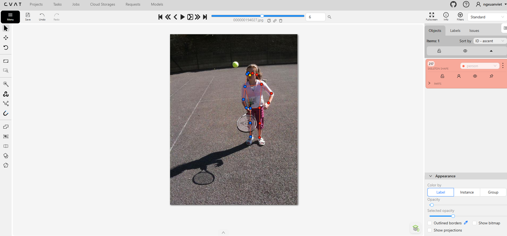
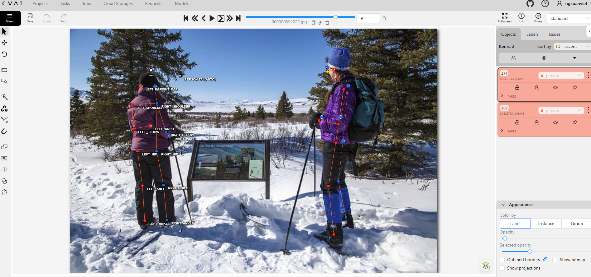
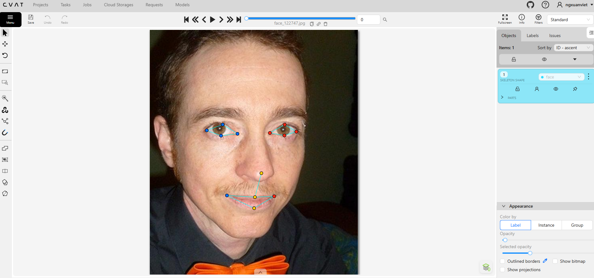
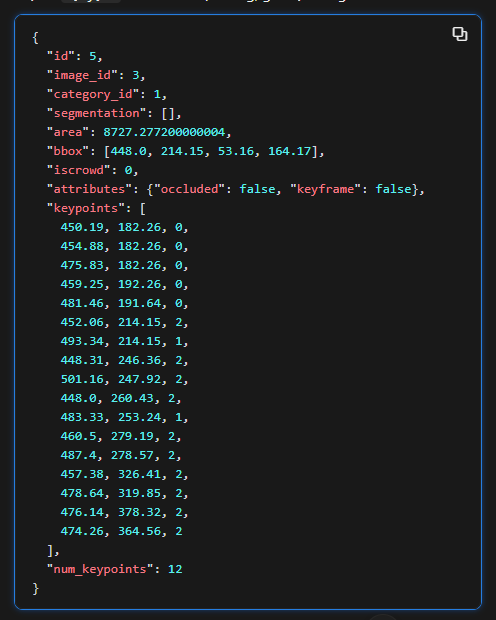

# Báo cáo cá nhân — NguyenXuanViet-2A202604045

Dữ liệu: 12 ảnh người COCO train2017 / val2017 (Lin et al., 2014) và 8 ảnh khuôn mặt cắt từ ảnh COCO, chỉ dùng trong lớp.

## 0. Thông tin học viên

- Họ tên: Nguyễn Xuân Việt
- MSSV: 2A202604045
- Email:
- Link repository: https://github.com/ngxuanviet/K5-L2B-DAY04-NguyenXuanViet-2A202604045-KeypointPose
- Phiên bản CVAT (Help → About): 2.74.1
- Máy: hệ điều hành Windows 11 Pro · RAM 16 GB · chạy CVAT chế độ đầy đủ
- Bộ ảnh (`src/exports/assignment.json` do `lab.py setup` tạo): có
- Giờ bắt đầu: 16:53 (12/11/2026)
- Giờ kết thúc: 18:30 (12/11/2026)

## 1. Kiểm tra label (CP0)

| Label | Kiểu | Số điểm | Tên điểm đúng bảng của lab? | Đúng thứ tự? | Số cạnh |
|---|---|---:|---|---|---:|
| `person` | Skeleton | 17 | Có | Có | 19 |
| `face` | Skeleton | 13 | Có | Có | 13 |

Label được kiểm bằng cách so danh sách sublabel của project `d04-keypoint` (tạo từ `src/lab/labels_d04_keypoint.json`) với `src/keypoint_schema.json`; file export cũng qua bước kiểm tên điểm của `check_submission.py`.

Mẫu `person` dựng theo người quay mặt về camera (các điểm `left_*` nằm bên phải khung mẫu)? Có (trong mẫu, `left_ankle` ở x = 60,5 và `right_ankle` ở x = 39,5).

Cách đổi cờ `occluded` / `outside` cho **một điểm** trên phiên bản CVAT này (một câu):

Rê chuột vào đúng điểm cho nó sáng lên rồi bấm `Q` (occluded) hoặc `O` (outside), hoặc chuột phải vào điểm và chọn nút tương ứng; chỉ điểm đó đổi, các điểm khác giữ nguyên.

## 2. Số lượng đã gán và thời gian (CP1, CP2)

| Nhóm ảnh | Số ảnh | Số skeleton đã gán | Số người dưới 60 px (không gán) | Số poster / gương / màn hình bỏ qua | Thời gian (phút) |
|---|---:|---:|---:|---:|---:|
| `easy` | 5 | 5 | 0 | 0 | xem ghi chú |
| `occluded` | 3 | 6 | 0 | 0 | xem ghi chú |
| `back` | 2 | 4 | 0 | 0 | xem ghi chú |
| `small` | 1 | 2 | 0 | 0 | xem ghi chú |
| `crowd` | 1 | 3 | 0 | 0 | xem ghi chú |
| `faces` | 8 | 8 | — | 0 | xem ghi chú |

Ghi chú thời gian (ghi đúng thực tế): vì nhãn ban đầu do model sinh cho cả 20 ảnh một lượt nên không tách được thời gian theo nhóm. Chạy model và AI soát overlay: khoảng 12 phút (17:08–17:20). Tôi tinh chỉnh tay trên CVAT cho cả 12 ảnh người và 8 ảnh mặt: khoảng 45 phút (17:20–18:07).

Hai người không gán, không thuộc diện dưới 60 px:

- `000000106051` (`small`): một người áo xanh ngọc đứng sau người áo tím, bị che gần hết (chỉ lộ một phần đầu và hai mép vai). Không gán vì không ước lượng chắc được điểm nào; xem bảng ca khó.
- `000000078170` (`occluded`): trong ô cửa sổ tối bên trái chỉ lộ một bàn tay cầm điện thoại của người thứ ba, không gán.

- Số ảnh người đã xong ở mốc phút 105: 12 / 10 (model sinh nhãn cho cả 12 ảnh từ phút thứ 27)
- Thời gian thực tế (phút): CP1 + CP2 khoảng 57 (12 phút máy + 45 phút tinh chỉnh tay) · CP3 gộp trong 45 phút tinh chỉnh
- Ảnh tốn thời gian nhất là ảnh nào, vì sao?

`000000078170` (hai người ngồi sau cửa sổ tàu, ảnh đen trắng): phần thân dưới khuất sau khung cửa và túi xách nên phải quyết định từng điểm hông, gối là `v = 1` hay `v = 0`, và model đặt gối, hông lệch 9–17 px so với chỗ tôi ước lượng.

## 3. Bảng ca khó (CP1, CP2)

| Ảnh | Người / mặt | Điểm | Cờ đã chọn | Phân vân giữa | Lý do chọn |
|---|---|---|---:|---|---|
| `000000054909` | cả hai người che ô (quay lưng) | mũi, hai mắt, hai tai | 0 | `v = 1` / `v = 0` | Đầu khuất hoàn toàn dưới ô, không thấy viền tai; ba người ước lượng sẽ tản mát nên chọn `outside` |
| `000000054909` | người bên phải | `right_shoulder` | 1 | `v = 2` / `v = 1` | Vai nằm ngay dưới mép ô, bị ô che; vị trí chắc nhờ cổ áo và cánh tay nên chọn `occluded` |
| `000000012552` | trọng tài và người bắt bóng (quay lưng, đeo mặt nạ) | mũi, hai mắt | 1 | `v = 1` / `v = 0` | Mặt nạ che mặt nhưng vị trí mặt xác định được từ mặt nạ và mũ; chọn `occluded` |
| `000000012552` | người bắt bóng | `right_wrist` | 0 | `v = 1` / `v = 0` | Tay phải khuất hẳn sau chân trọng tài, không có đoạn chi nào để lần theo |
| `000000078170` | người bên phải | `right_elbow`, `right_wrist` | 0 | `v = 1` / `v = 0` | Tay phải chìm trong vùng tối sau khung cửa, model đặt ra ngoài cả ô cửa; không ước lượng chắc được |
| `000000078170` | người bên trái | hai gối | 1 | `v = 1` / `v = 0` | Thấy đùi kéo dài tới mép khung cửa nên ước lượng được gối; cổ chân khuất hẳn dưới thành tàu nên `v = 0` |
| `000000106051` | người áo tím (quay lưng) | `left_ankle` | 2 | `v = 0` / `v = 2` | Lúc đầu để `outside` vì cỏ che; phóng to thấy được cổ chân trái nên sửa thành thấy rõ và đặt lại vị trí |
| `000000106051` | người áo xanh ngọc phía sau | cả người | không gán | gán / không gán | Bị người phía trước che gần hết; theo guideline người lộ đầu và vai vẫn nên gán, nhưng ở đây không có điểm nào đặt chắc được |
| `000000177338` | người lái xe máy (gần camera) | `right_ankle` | 0 | `v = 2` / `v = 0` | Bàn chân sát mép dưới ảnh, khớp cổ chân thật nằm ngoài khung nên chọn `outside`, không kéo về mép |
| `000000521817` | cậu bé | hai cổ chân | 0 | `v = 1` / `v = 0` | Ống quần chạm mép dưới ảnh, không thấy bàn chân; cổ chân nằm ngoài khung |
| `face_264124` | mặt nghiêng | `right_eye_inner` | 1 | `v = 2` / `v = 1` | Khóe trong mắt xa bị sống mũi che một phần; đoán chắc được nên `occluded` |
| `face_333134`, `face_469647` | tóc che | các điểm mắt dưới tóc | 2 | `v = 2` / `v = 1` | Tóc lòa xòa mỏng, vẫn thấy mép mí qua tóc nên giữ `v = 2` |

## 4. Bảng tự review (CP3)

Cách review: nhãn ban đầu do model sinh; tôi soát trên CVAT với tên điểm bật, đi từ ảnh cuối về ảnh đầu, và mọi chỗ tôi sửa đều được ghi lại bằng cách so nhãn trên CVAT sau khi sửa với nhãn model (tọa độ và cờ trước → sau). Bảng dưới lấy từ danh sách đó.

| Ảnh | Người / mặt | Điểm | Mã lỗi | Ghi chú | Đã sửa? |
|---|---|---|---|---|---|
| `000000521817` (`occluded`) | cậu bé | `left_wrist`, `left_ear` | `position` | Lệch 9 px và 7 px so với khớp; hướng người (lưng quay về camera, mặt ngoảnh lại) đã kiểm, không `lr_swap` | Có |
| `000000391222` (`back`) | người đứng nghiêng bên phải | `right_ear`, `right_wrist` | `vis_flag` | Tai phải để `v = 0` nhưng thấy viền tai dưới mũ → `v = 2`; cổ tay phải khuất sau găng → `v = 2` thành `v = 1` | Có |
| `000000391222` (`back`) | người quay lưng bên trái | cả người | `ok` | Left nằm bên trái ảnh, mũi và mắt `v = 0` | — |
| `000000177338` (`occluded`) | người lái xe máy | `left_ear`, `right_ankle`, `left_elbow`, `left_hip` | `vis_flag` | Tai trái `v = 0` → `v = 2` và dời 11 px; cổ chân phải ngoài khung `v = 2` → `v = 0`; khuỷu trái, hông trái `v = 2` → `v = 1` | Có |
| `000000177338` (`occluded`) | người lái ATV | `left_ankle` | `vis_flag` | Cổ chân trái khuất hẳn sau xe, không đoán chắc: `v = 1` → `v = 0` | Có |
| `000000106051` (`small`) | người áo tím | `left_ankle`, `left_ear`, `nose`, `left_eye` | `vis_flag` | Cổ chân trái `v = 0` → `v = 2` và dời 24 px; tai trái `v = 0` → `v = 2`; mũi, mắt trái `v = 0` → `v = 1` | Có |
| `000000106051` (`small`) | người dắt ngựa | `right_ankle` | `position` | Lệch 10 px (cỏ che) | Có |
| `000000054909` (`back`) | người bên phải | `right_shoulder` | `vis_flag` | Vai bị mép ô che: `v = 2` → `v = 1` | Có |
| `000000078170` (`occluded`) | cả hai người | hông, gối | `position` | Gối người trái lệch 9–12 px, hông người phải lệch 12–17 px | Có |
| `000000012552` (`crowd`) | trọng tài | `right_wrist`, `right_eye` | `vis_flag` | Cổ tay phải nằm trong găng sau hông: `v = 2` → `v = 1`; mắt phải dời 7 px (`position`) | Có |
| `000000012552` (`crowd`) | người đánh bóng | hai cổ chân | `ok` | Script cảnh báo cặp cổ chân ngược phía; kiểm lại là vặn người khi vung gậy, không phải `lr_swap` | — |
| `face_85624` | mặt | `right_eye_upper`, `left_eye_upper/lower` | `position` | Mí trên mắt phải lệch 7 px khỏi điểm ngay trên con ngươi | Có |
| `face_333134` | mặt (tóc che) | `nose_tip`, `lip_upper`, `lip_lower`, khóe mắt | `position` | Mặt cúi xuống nên model lệch 8–10 px ở mũi và môi, 6–7 px ở khóe mắt phải | Có |
| `face_264124` | mặt nghiêng | `right_eye_inner`; `lip_upper`, `lip_lower` | `vis_flag` | Khóe trong mắt xa `v = 2` → `v = 1`; hai điểm môi lệch 9–10 px (`position`) | Có |
| `face_122747` | mặt | hai `*_eye_upper`, `lip_lower` | `position` | Mí trên lệch 7 px về phía khóe, môi dưới lệch 7 px | Có |

Tổng hợp số lỗi theo mã (đếm theo dòng của bảng):

| `lr_swap` | `vis_flag` | `position` | `missing` | `extra` | `ok` |
|---:|---:|---:|---:|---:|---:|
| 0 | 7 | 6 | 0 | 0 | 2 |

Điểm còn phân vân giữa `v = 1` và `v = 0` (ghi cả hai lựa chọn và lý do chọn):

- Mũi và mắt của trọng tài, người bắt bóng trong `000000012552`: chọn `v = 1` (vị trí mặt nạ cho biết khá chắc), phương án kia là `v = 0` (người quay lưng, không thấy mặt).
- Hông của hai người trong `000000078170`: người trái tôi để `v = 2` (thấy phần hông trên đùi), người phải `v = 1` (khuất sau túi ni lông); phương án kia là `v = 0` cho người phải.
- Người áo xanh ngọc trong `000000106051`: chọn không gán; phương án kia là gán đầu và hai vai `v = 1`.

## 5. Kiểm file xuất và kết quả tự kiểm (CP4)

Tự kiểm tay trong file JSON:

| File | Người / mặt kiểm (ảnh, thứ tự) | Số phần tử `keypoints` | Điểm `outside` ra `v = 0`, `occluded` ra `v = 1`? | `num_keypoints` khớp? |
|---|---|---:|---|---|
| `NguyenXuanViet_persons.zip` | `000000054909.jpg`, người #1 | 51 | Có: mũi, mắt, tai ra `v = 0`; `right_shoulder`, `right_wrist` ra `v = 1` | Có (12 = 12) |
| `NguyenXuanViet_persons.zip` | `000000078170.jpg`, người #2 | 51 | Có: `right_elbow`, `right_wrist`, gối, cổ chân ra `v = 0`; `right_ear`, hai hông ra `v = 1` | Có (11 = 11) |
| `NguyenXuanViet_faces.zip` | `face_301643.jpg` (kính râm) | 39 | Có: 8 điểm mắt ra `v = 1` | Có (13 = 13) |

Sau khi xuất, CVAT ghi `occluded` thành `v = 1` và `outside` thành `v = 0`. Tọa độ của điểm `outside` trong file là `0, 0` hay tọa độ cũ? Tọa độ cũ (ví dụ `450.19, 182.26, 0`).

Hai job đã chuyển sang completed trên CVAT? Có

Dán phần **TÓM TẮT** in ra từ `src/check_submission.py`:

```text
----- TÓM TẮT (dán vào báo cáo mục 5) -----
- File person: NguyenXuanViet_persons.zip
  Số ảnh: 12 · số skeleton `person`: 20 · mỗi annotation 51 số
  Skeleton theo ảnh: 000000012552=3, 000000043968=1, 000000054909=2, 000000078170=2, 000000106051=2, 000000177338=2, 000000194027=1, 000000205650=1, 000000343057=1, 000000391222=2, 000000431893=1, 000000521817=2
  Cờ v: v=2 232 (68%) · v=1 79 (23%) · v=0 29 (9%)
  num_keypoints trung bình: 15.6
- File face: NguyenXuanViet_faces.zip
  Số ảnh: 8 · số skeleton `face`: 8 · mỗi annotation 39 số
  Skeleton theo ảnh: face_122747=1, face_249336=1, face_264124=1, face_301643=1, face_333134=1, face_436791=1, face_469647=1, face_85624=1
  Cờ v: v=2 95 (91%) · v=1 9 (9%) · v=0 0 (0%)
  num_keypoints trung bình: 13.0
- Ghi chú: 29 điểm v = 0 vẫn mang tọa độ cũ (CVAT 2.x xuất như vậy; chuẩn COCO ghi 0, 0). Không phải lỗi: điểm v = 0 bị bỏ qua khi huấn luyện và khi chấm.
- Số [LỖI]: 0 · số [CẢNH BÁO]: 4
Kết quả: ĐẠT (đọc lại từng cảnh báo ở trên)
```

Các `[CẢNH BÁO]` còn giữ nguyên và lý do (cả bốn đều là "cặp trái/phải nằm ngược phía", đã kiểm lại hướng người, là tư thế thật):

- `000000012552` người đánh bóng, cặp `ankle`: đang vặn người vung gậy, thân trên xoay lưng về camera còn chân vẫn hướng về gôn.
- `000000043968` người trượt ván tuyết, cặp `hip`, `knee`, `ankle`: hai chân đứng ngang trên ván (hướng sang phải ảnh), vai và mặt xoay về camera.
- `000000343057` người trượt tuyết, cặp `knee`, `ankle`: người đứng nghiêng hướng sang phải ảnh, thân trên xoay về camera.
- `000000521817` cậu bé, cặp `eye`, `ear`: lưng quay về camera nhưng mặt ngoảnh lại nhìn camera.

## 6. Ảnh chụp màn hình

1. Label `person` trong label constructor (đủ 17 điểm có tên):

   

2. Một người quay lưng đã gán, cờ đã đặt:

   

3. Một khuôn mặt đã gán 13 điểm, phóng to vùng mắt:

   

4. Một đoạn JSON xuất của một người:

   

Nguồn ảnh: COCO 2017.

## 7. Tự đánh giá

1. Lỗi bạn mắc nhiều nhất hôm nay, và cách bạn sẽ tránh ở dự án thật:

   Nhiều nhất là `vis_flag` (7 trong 13 dòng lỗi của bảng review), kế đến là `position`. Nguyên nhân: nhãn ban đầu lấy cờ từ độ tin cậy của model, mà độ tin cậy không phải là "nhìn thấy hay không": model tự tin vẫn đặt `v = 2` cho khớp khuất sau ô hay sau găng, và ngược lại. Không có `lr_swap` nào, kể cả ở nhóm `back` và `crowd`. Ở dự án thật, nếu dùng model để gán trước, tôi sẽ coi cờ `v` là phần **luôn phải người quyết định** theo bốn câu hỏi của guideline, và soát riêng một lượt chỉ cho cờ (tách khỏi lượt soát vị trí).

2. Một quy tắc bạn đề xuất thêm vào guideline (kèm ảnh ví dụ nếu có):

   Thêm quy tắc cho **mặt bị vật đội che** (mặt nạ bóng chày, mũ bảo hiểm kín, ô): nếu vật che bám theo đầu (mặt nạ, mũ) thì mũi, mắt là `v = 1` vì vị trí suy ra chắc từ vật đó; nếu vật che không bám theo đầu (ô, biển báo) thì `v = 0`. Ví dụ: `000000012552` (mặt nạ → `v = 1`) và `000000054909` (ô → `v = 0`).

3. Nhãn của bạn đi vào model ở đâu? Chọn một lỗi bạn đã sửa và nói nó sẽ làm model học sai thế nào (heatmap, trọng số trong loss, hay bước lật ảnh):

   Lỗi đã sửa: `right_ankle` của người lái xe máy trong `000000177338` ban đầu là `v = 2` trong khi khớp thật nằm ngoài khung. Nếu giữ nguyên, điểm đó có trọng số 1 trong loss và tạo một đỉnh heatmap ở sát mép ảnh; model sẽ học rằng "cổ chân bị cắt khung thì nằm ở mép", tức là học đoán bừa. Sửa thành `v = 0` thì trọng số bằng 0, model không bị phạt hay bị dạy sai ở điểm đó.

## 8. Khó khăn và lỗi kỹ thuật

- Máy chỉ có Python 3.15, chưa có bản cài cho các thư viện model, nên quyết định chạy model trong Docker.
- MediaPipe trong container báo thiếu `libEGL.so.1`; cài thêm `libegl1`, `libgles2` thì chạy được.
- CVAT trên máy là bản 2.74.1, khác bản 2.82 mà tài liệu lab dùng để kiểm; các thao tác đổi cờ và export vẫn cho kết quả như tài liệu mô tả (`occluded` → `v = 1`, `outside` → `v = 0`, giữ tọa độ cũ).

## Bonus (nếu làm)

Nhãn bonus cũng do model sinh và AI soát overlay như bài chính; sau đó tôi chỉnh tay trên CVAT (B1: sửa cờ 10 điểm và dời 4 điểm, ví dụ bỏ 5 điểm mặt của một người quay lưng trong `000000161603` về `v = 0`; B2: dời mí mắt và mép môi 2–7 px ở cả 5 ảnh).

### B1 — 3 ảnh người khó thêm

| Ảnh | Số skeleton | Số người dưới 60 px | Ca khó nhất |
|---|---:|---:|---|
| `000000005294` | 3 | khoảng 11 (người đi bộ phía xa, cao 6–42 px) | Ba người ngồi ghế đọc báo, tờ báo che gần hết thân trên; người ngoài cùng bên trái chỉ lộ chân và một bàn tay nên đầu, vai, tay trái để `v = 0`. Hình người trên tấm áp phích phía sau không gán |
| `000000161603` | 4 | 0 | Bốn người đứng sau con bò: chân khuất sau lưng bò nên gối, cổ chân của hai người để `v = 0` (script cảnh báo một người "trải cao 43 px" vì chỉ còn nửa thân trên có điểm) |
| `000000357549` | 3 | 0 | Người sát mép trái bị cắt nửa người: toàn bộ bên phải của họ nằm ngoài khung nên `v = 0`; người lên tàu bị người đi xe đạp che tay phải |

Kết quả `src/check_submission.py` cho `NguyenXuanViet_bonus_persons.zip`:

```text
- File person: NguyenXuanViet_bonus_persons.zip
  Số ảnh: 3 · số skeleton `person`: 10 · mỗi annotation 51 số
  Skeleton theo ảnh: 000000005294=3, 000000161603=4, 000000357549=3
  Cờ v: v=2 102 (60%) · v=1 26 (15%) · v=0 42 (25%)
  num_keypoints trung bình: 12.8
- Số [LỖI]: 0 · số [CẢNH BÁO]: 5
Kết quả: ĐẠT (đọc lại từng cảnh báo ở trên)
```

Cảnh báo còn giữ: `000000161603` có người "trải cao dưới 60 px" (người cao hơn 60 px nhưng thân dưới khuất sau con bò); `000000357549` người sát mép trái có `left_eye` `v = 2` cách mép ảnh 1 px (mắt nằm ngay rìa khung, vẫn trong ảnh); các cảnh báo cặp trái/phải ngược phía là tư thế thật.

### B2 — 5 ảnh khuôn mặt đen trắng / hồng ngoại

Ảnh không màu mất ranh giới màu giữa môi và da, giữa lòng trắng mắt và mí, nên mép ngoài môi (`lip_upper`, `lip_lower`) và khóe miệng chỉ còn dựa vào độ sáng; râu, bóng đổ và hạt nhiễu ảnh cũ dễ bị nhầm thành mép môi hay mép mí (ví dụ `face_300200` có râu rậm phủ khóe miệng). Khóe mắt trong vùng bóng hốc mắt cũng khó tách khỏi nếp nhăn. Với kính râm trên ảnh hồng ngoại: cờ phụ thuộc vào việc **có nhìn thấy mắt hay không**, không phụ thuộc vào việc có đeo kính. Nhiều loại tròng kính râm cho ánh sáng hồng ngoại gần đi qua, khi đó mắt hiện rõ sau kính và các điểm mắt là `v = 2`; nếu tròng vẫn tối trên ảnh hồng ngoại thì vẫn là `v = 1`, đặt theo gọng. Kết quả `check_submission.py` cho `NguyenXuanViet_bonus_faces.zip`: 5 ảnh, 5 skeleton, 0 lỗi, 0 cảnh báo, `Kết quả: ĐẠT`.

### B3 — Model so với nhãn của tôi (không tính điểm)

Không làm mục này.

## 9. Tài liệu tham khảo và công cụ AI đã dùng

Việc dùng model pretrain và AI để gán nhanh đã được coach đồng ý trên lớp.

- **Claude Code**: viết script chạy model, script đẩy nhãn vào CVAT qua REST API; soạn báo cáo này từ dữ liệu của job.
- **RTMPose-x (body7, 384×288) + detector YOLOX-x**, qua thư viện `rtmlib` / ONNX Runtime: sinh 17 điểm COCO cho ảnh người (model chính).
- **Ultralytics YOLO11x-pose**: chạy song song để đối chiếu, đánh dấu các điểm hai model lệch nhau.
- **MediaPipe Face Landmarker** (478 điểm): lấy 13 điểm của lab theo chỉ số 263, 362, 386, 374 (mắt trái), 33, 133, 159, 145 (mắt phải), 4 (chóp mũi), 291, 61 (khóe miệng), 0, 17 (môi trên, môi dưới).
- Tất cả model chạy local trong Docker; không đưa ảnh lên dịch vụ ngoài. Không dùng annotation gốc của COCO.
- Phần của tôi: tinh chỉnh tay trên CVAT (khoảng 45 điểm ở ảnh người và 60 điểm ở ảnh mặt được dời hoặc đổi cờ, liệt kê ở mục 4), quyết định các ca khó, và chụp ảnh màn hình.
- File nộp được export trực tiếp từ CVAT bằng `python lab.py export`, không sửa JSON bằng tay.
- Tài liệu: `docs/GUIDELINE.md`, `docs/COCO_KEYPOINTS.md`, `docs/CVAT_CHEATSHEET.md` của repo; Lin et al., 2014, *Microsoft COCO*.
